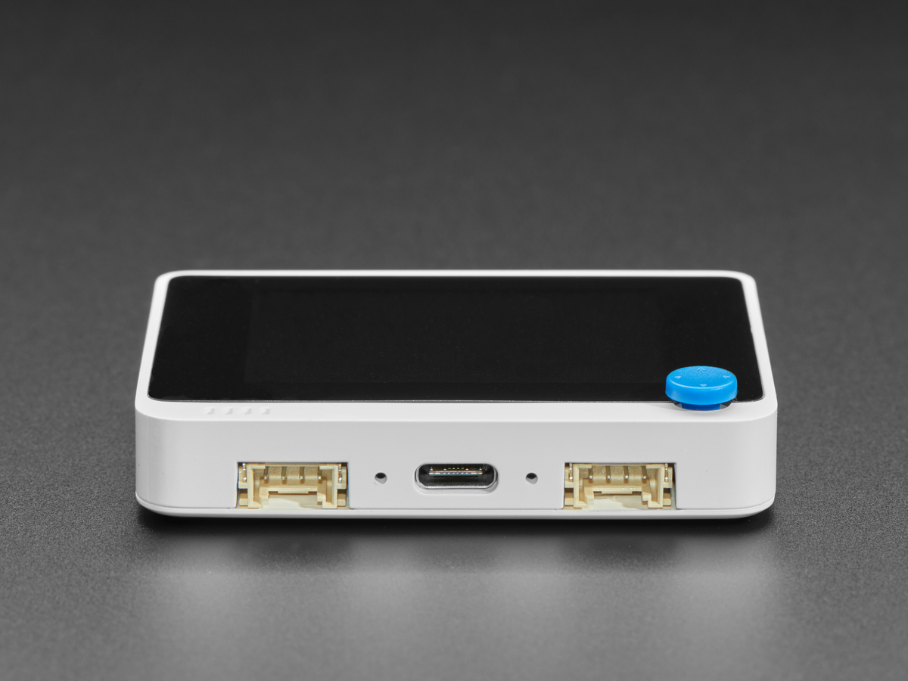

    <h1>WEEK 4 — SEEED STUDIO WIO TERMINAL</h1>

    

        Arduino IDE • Game Development • Hardware Experiments
         
        Նախագիծը կատարել ենք ես և Վահագնը։
    

    

        <h2>1. Նախագծի մասին</h2>

        

            Այս շաբաթվա ընթացքում ես և Վահագնը աշխատեցինք
            Seeed Studio Wio Terminal սարքի հետ։ Մեր նպատակն էր
            ուսումնասիրել դրա հնարավորությունները և փորձել
            սարքի վրա տարբեր խաղեր տեղադրել ու աշխատեցնել։
        

        

            Wio Terminal-ը փոքր ծրագրավորվող սարք է, որն ունի
            գունավոր էկրան, ջոյսթիկ, կոճակներ և ներկառուցված
            շարժման սենսոր։ Այս հնարավորությունները մեզ
            հնարավորություն տվեցին փորձել ստեղծել տարբեր
            տեսակի խաղեր։
        

        
        

        

            Նկար 1․ Seeed Studio Wio Terminal սարքը։
        

    

    

        <h2>2. Arduino IDE-ի կարգավորումը</h2>

        

            Աշխատանքը սկսեցինք Arduino IDE ծրագրից։
            Այն օգտագործեցինք կոդերը բացելու, փոփոխելու և
            Wio Terminal սարքի մեջ ներբեռնելու համար։
        

        

            Սկզբում անհրաժեշտ էր ներբեռնել և տեղադրել տարբեր
            գրադարաններ (Libraries), որպեսզի ծրագրերը կարողանային
            աշխատել սարքի բաղադրիչների հետ։
        

        

            Սակայն այս գործընթացը մի փոքր բարդ էր։ Գրադարաններից
            մեկի տեղադրման ժամանակ Arduino IDE-ն անընդհատ Error
            էր ցույց տալիս և հայտնում, որ գրադարանը տեղադրված չէ,
            չնայած մենք արդեն ներբեռնել էինք այն։
        

        

            Մի քանի փորձից հետո հասկացանք, որ անհրաժեշտ են նաև
            այլ գրադարաններ։ Ընդհանուր առմամբ տեղադրեցինք երեք
            գրադարան, որից հետո կարողացանք շարունակել աշխատանքը։
        

    

    

        <h2>3. Առաջին փորձը — Acceleration Game</h2>

        

            Մեր առաջին փորձը շարժման սենսորի՝ acceleration-ի
            վրա հիմնված խաղն էր։ Մտածել էինք, որ կարող ենք
            խաղը կառավարել սարքը շարժելով կամ թեքելով։
        

        

            Մեզ հետաքրքիր էր օգտագործել Wio Terminal-ի
            ներկառուցված սենսորը և տեսնել, թե ինչպես այն
            կարձագանքի մեր շարժումներին։
        

        

            Սակայն խաղը սպասվածի պես չաշխատեց։ Շարժումները
            միշտ չէ, որ ճիշտ էին արձանագրվում, իսկ կառավարումը
            բավականաչափ սահուն չէր։ Փորձեցինք հասկանալ խնդիրը,
            բայց չկարողացանք ստանալ լիարժեք աշխատող տարբերակ։
        

        

        

            Նկար 2․ Շարժման սենսորով խաղի փորձարկում։
        

    

    

        <h2>4. Երկրորդ փորձը — Football Penalty Game</h2>

        

            Առաջին խաղից հետո որոշեցինք փորձել մեկ այլ տարբերակ։
            Ինտերնետից գտանք ֆուտբոլային խաղի կոդ, որի միջոցով
            պետք էր կատարել 11-մետրանոց հարված։
        

        

            Խաղի գաղափարն այն էր, որ ջոյսթիկի միջոցով ընտրեինք
            հարվածի ուղղությունը և փորձեինք գոլ խփել։
            Մեզ դուր եկավ այս գաղափարը, քանի որ այն թույլ էր
            տալիս օգտագործել սարքի էկրանն ու ջոյսթիկը։
        

        

            Կոդը տեղադրեցինք Arduino IDE-ում և փորձեցինք
            ներբեռնել սարքի մեջ։ Սակայն առաջին փորձից հետո
            էկրանը սև էր մնում, և խաղը չէր ցուցադրվում։
        

        

        

            Նկար 3․ Ֆուտբոլային խաղի առաջին փորձի ժամանակ
            առաջացած սև էկրանի խնդիրը։
        

    

    

        <h2>5. Կոդի ուղղումը ChatGPT-ի օգնությամբ</h2>

        

            Քանի որ չկարողացանք ինքնուրույն լուծել սև էկրանի
            խնդիրը, որոշեցինք դիմել ChatGPT-ին։ Տրամադրեցինք
            մեր օգտագործած կոդը և խնդրեցինք այն փոփոխել ու
            հարմարեցնել Wio Terminal սարքին։
        

        

            Ստացված նոր կոդը տեղադրեցինք Arduino IDE-ում և
            կրկին ներբեռնեցինք սարքի մեջ։
        

        

            Այս անգամ արդյունքը փոխվեց․ սև էկրանի փոխարեն
            հայտնվեց սպիտակ էկրան։ Սակայն խաղը դեռ չէր
            աշխատում, և մենք չկարողացանք ստանալ ցանկալի արդյունքը։
        

        

        

            Նկար 4․ Կոդի փոփոխությունից հետո առաջացած
            սպիտակ էկրանի խնդիրը։
        

    

    

        <h2>6. Աշխատանքի ընթացքում հանդիպած խնդիրները</h2>

        <ul>
            <li>
                Գրադարաններից մեկը ներբեռնելուց հետո Arduino IDE-ն
                շարունակում էր հայտնել, որ այն տեղադրված չէ։
            </li>
            <li>
                Անհրաժեշտ եղավ տեղադրել ընդհանուր երեք գրադարան։
            </li>
            <li>
                Acceleration խաղը ճիշտ և սահուն չէր աշխատում։
            </li>
            <li>
                Ֆուտբոլային խաղի առաջին տարբերակը ցույց էր տալիս
                սև էկրան։
            </li>
            <li>
                ChatGPT-ի օգնությամբ կոդը փոփոխելուց հետո
                հայտնվեց սպիտակ էկրան։
            </li>
        </ul>
    

    

        <h2>7. Ինչ սովորեցինք</h2>

        

            Այս աշխատանքի ընթացքում մենք ավելի լավ ծանոթացանք
            Arduino IDE ծրագրին և Wio Terminal սարքի
            հնարավորություններին։
        

        

            Սովորեցինք, թե ինչ նշանակություն ունեն գրադարանները,
            ինչպես են ծրագրերը ներբեռնվում սարքի մեջ և ինչ
            խնդիրներ կարող են առաջանալ կոդը գործարկելիս։
        

        

            Նաև հասկացանք, որ ինտերնետից գտնված կոդերը միշտ չէ,
            որ անմիջապես աշխատում են։ Դրանք երբեմն անհրաժեշտ է
            փոփոխել և հարմարեցնել տվյալ սարքին։
        

    

    

        <h2>8. Եզրակացություն</h2>

        

            Ընդհանուր առմամբ, ես և Վահագնը փորձեցինք աշխատեցնել
            երկու տարբեր խաղ։ Առաջինը շարժման սենսորի վրա
            հիմնված խաղն էր, իսկ երկրորդը՝ ֆուտբոլային
            11-մետրանոցների խաղը։
        

        

            Չնայած նրան, որ երկու փորձերից ոչ մեկը չավարտվեց
            լիարժեք աշխատող խաղով, մենք ձեռք բերեցինք նոր
            գիտելիքներ և գործնական փորձ։ Սովորեցինք աշխատել
            գրադարանների հետ, փորձարկել տարբեր կոդեր և
            փնտրել առաջացած խնդիրների լուծումները։
        

        

            Այս նախագիծը մեզ ցույց տվեց, որ ծրագրավորման
            ընթացքում սխալները բնական են, և կարևոր է
            շարունակել փորձարկել ու սովորել դրանցից։
        

    

